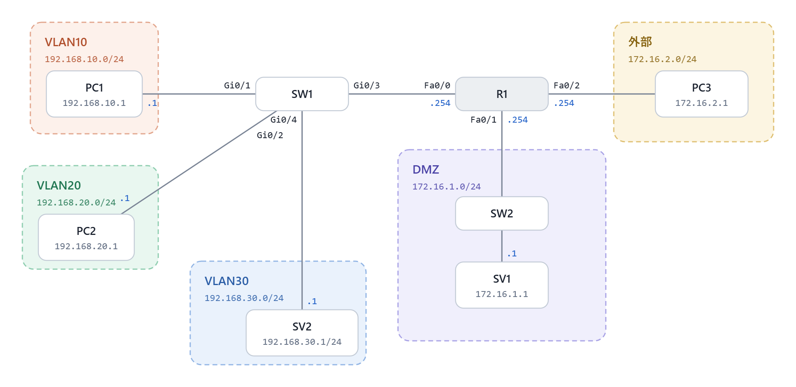

# 社内ネットワーク分離とACLによるアクセス制御(Packet Tracer)

Cisco Packet Tracer で、社員PC・社内サーバー・管理用ネットワークを VLAN で分離し、
拡張ACLで通信を制御した検証環境です。前回作成した DMZ・外部との通信ルールも維持しています。

## 構成図

| ゾーン | ネットワーク | 接続 | 機器 |
|---|---|---|---|
| 社員PC | VLAN10 / 192.168.10.0/24 | SW1 → R1 Fa0/0.10 | PC1 |
| 管理用 | VLAN20 / 192.168.20.0/24 | SW1 → R1 Fa0/0.20 | PC2(管理用PC) |
| 社内サーバー | VLAN30 / 192.168.30.0/24 | SW1 → R1 Fa0/0.30 | SV2 |
| DMZ | 172.16.1.0/24 | R1 Fa0/1 → SW2 | SV1(公開Webサーバー) |
| 外部 | 172.16.2.0/24 | R1 Fa0/2 | PC3 |

社内の3つのVLANは、SW1とR1をトランク1本で接続するルーター・オン・ア・スティック構成です。

## 要件

1. 社員PC・社内サーバー・ネットワーク機器の管理用で、ネットワークを分けること
2. 社員PCから社内サーバーへは、Web閲覧(HTTP)とpingのみ許可すること
3. 管理用ネットワークからは、すべての機器に接続できること
4. 社員PCから管理用ネットワークへは接続できないこと
5. 前回作ったDMZ・外部との通信ルールは維持すること

前回のルール(要件5の中身)

| 通信 | 結果 |
|---|---|
| 外部 → DMZのWebサーバー(HTTPのみ) | 許可 |
| 外部 → 社内LAN | 拒否 |
| 社内LAN → DMZ | 許可 |
| DMZ → 社内LAN(新規の通信) | 拒否 |

## ACLの適用箇所

| ACL | 適用インターフェース | 方向 | 役割 |
|---|---|---|---|
| ACL1 | R1 Fa0/0.10(社員PC) | in | 社員PCから出ていく通信を制限(要件2・4、ルールG) |
| ACL2 | R1 Fa0/2(外部) | in | 外部から入ってくる通信を制限(ルールE・F) |
| ACL3 | R1 Fa0/1(DMZ) | in | DMZから社内への新規通信を拒否し、返事だけ通す(ルールG・H) |

詳細は [parameter-sheet.md](parameter-sheet.md)、試験内容は [test-results.md](test-results.md) を参照。

## 設計のポイント

### 拡張ACLは送信元の近く(in方向)に置く
送信元・宛先・プロトコルまで指定できる拡張ACLは、不要な通信をルーターの奥まで流さないよう、送信元に近いインターフェースの in 方向に適用しました。

### 社内サーバーとDMZのサーバーを分ける
Webで使うサーバーでも、外部から接続されるもの(SV1)はDMZ、社員だけが使うもの(SV2)は社内に置いています。DMZに置くかどうかは「通信方法」ではなく「外部から接続されるかどうか」で判断しました。

### 「行き」と「返り」を分けて考える
「管理用 → 社員PCは許可」「社員PC → 管理用は拒否」を両立するため、社員PC側のACLでは管理用宛ての通信を拒否しつつ、ping の返事(`echo-reply`)だけを許可しています。
DMZ → 社内も同様に、新規の通信は拒否し、社内から始めた通信の返事(ICMP `echo-reply`、TCP `established`)だけを許可しています。

### 管理用ネットワークにはACLをかけない
要件3のとおり管理用からの通信は制限しません。返事が社員PC側・外部側・DMZ側のACLを通る場合だけ、返事を許可する行を各ACLに追加しています。

### 行番号に間隔をあける
名前付きACLの行番号を10刻みにし、暗黙のdenyを明示した `999 deny ip any any` で一致回数を確認できるようにしました。後から行を差し込む余地を残しています。

## 制約・今後の課題

- ルーターの標準的なACLでは UDP の「返事だけ」を区別できないため、DMZからの返事として通すのは TCP と ICMP(ping)に限定しています。完全に実現するにはステートフルなFW(ASAなど)が必要です。
- 社内 → 外部の通信は要件の対象外のため制御していません(現状の動作は試験結果に記載)。
- スイッチ(SW1・SW2)には管理用IPを設定していないため、管理用ネットワークからスイッチへの接続は未対応です。今後、SW1のVLAN20にSVIを設定し、SSHでのリモート管理を追加する予定です。管理用PCと同じVLAN20に置けば、通信はルーターを経由しないため既存のACLの変更は不要です。

## 使用ツール

- Cisco Packet Tracer 9.0.1
